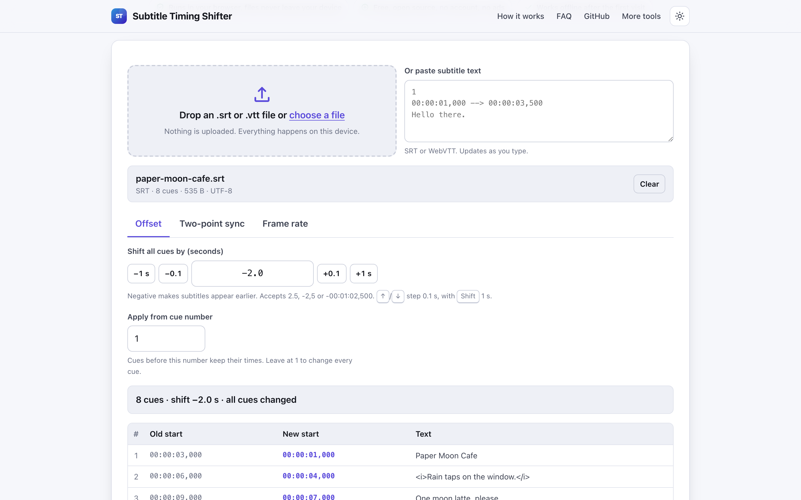
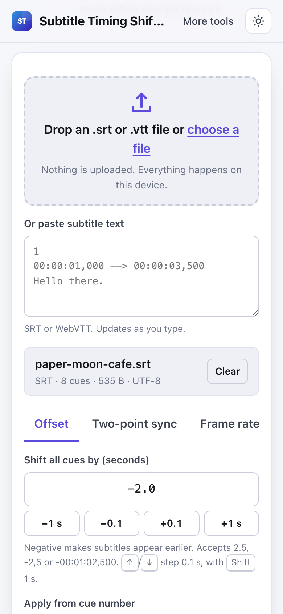

# Subtitle Timing Shifter

> Shift or stretch SRT and VTT subtitle timing to fix out of sync captions in your browser, no upload.

**🌐 Use it now: [turhe123.github.io/subtitle-timing-shifter](https://turhe123.github.io/subtitle-timing-shifter/)** · free · open source · runs in your browser · works offline


## Why

Out of sync subtitles are a common annoyance, and most online fixes ask you to upload the subtitle file, show ads, limit how many files you can fix per day, or require an account for extra features. Subtitle Timing Shifter is a free, open-source alternative to Subtitle Tools Sync and online subtitle shifters. Your files never leave your device, there is no account, no ads and no limits, it works offline, and it can be installed as an app.

## Screenshots

<p align="center"></p>

<p align="center"><em>Subtitle Timing Shifter in the browser, light theme</em></p>

<p align="center"></p>

<p align="center"><em>Subtitle Timing Shifter on a phone</em></p>

## Features

- **Offset mode:** add or subtract seconds and milliseconds from every cue. Plus and minus buttons step by 0.1 s and 1 s. In the field, Arrow Up/Down steps 0.1 s and Shift+Arrow steps 1 s.
- **Flexible offset input:** accepts `2.5`, `-2,5` (comma decimal separator) or a timestamp such as `-00:01:02,500`.
- **Two-point sync:** pick a first cue and a later cue, type the times they should start at, and the tool computes a linear scale and offset applied to all cues. This fixes drift that a constant offset cannot.
- **Frame rate conversion:** scale times by the ratio of a source and target frame rate (23.976, 24, 25, 29.97, 30, 50, 59.94, 60 fps).
- **Apply from cue number:** leave earlier cues untouched and change only the cues from a chosen number onward (works in every mode).
- **Live preview table:** old start and new start side by side with the cue text. The first 20 cues are shown, with a button to show all.
- **Clamping and warnings:** times that would go below zero are clamped to `00:00:00` and the summary reports how many cues were affected, including cues that end up not shown. It also warns when a cue's end would land before its start, and when the shift is longer than the whole file.
- **Download or copy:** the download keeps the input format (SRT or VTT) and adds `.synced` before the extension (for example `movie.synced.srt`). A Copy text button is also provided.
- **Input:** drop or choose one file, or paste text. Only the first file is used if several are dropped. Unreadable or non-subtitle files show an inline error.
- **Preserved as-is:** cue text, tags, identifiers, WebVTT headers, notes and settings, and the original line endings. Right-to-left text and Unicode are supported.
- **Encoding handling:** UTF-8 and UTF-16 byte order marks are detected, with a Windows-1252 fallback. Files not in UTF-8 are saved as UTF-8, and the tool says so.
- **Precision:** times are stored as integer milliseconds to avoid float drift.
- Light and dark themes, usable with the keyboard and at 390 px wide.

**Formats:** input `.srt` and `.vtt` (or pasted text); output is the same format as the input.

**Limits:** timing only. It does not edit text, convert between SRT and VTT, or support other subtitle formats. There is no fixed file size limit; very large files are bounded by your browser's memory.

## How to use

1. Drop an `.srt` or `.vtt` file onto the page, choose one, or paste the subtitle text.
2. Pick a mode: Offset, Two-point sync, or Frame rate, and enter the values. Optionally set the cue number to start from.
3. Check the preview table and the summary line for old and new times and any warnings.
4. Click Download to save the synced file, or Copy text to copy it.

## Privacy

- Nothing is uploaded. Files are read and processed in your browser, and the page makes no requests with your data.
- No cookies.
- Page views are counted anonymously with [GoatCounter](https://www.goatcounter.com/), which is cookieless and open source.
- After the first visit a service worker caches the page so it works offline.

## Run it locally

```sh
git clone https://github.com/turhe123/subtitle-timing-shifter
cd subtitle-timing-shifter
python3 -m http.server 4173
```

Then open http://127.0.0.1:4173/. There is no build step.

## Tests

```sh
npm i -D @playwright/test && npx playwright install chromium
npx playwright test
```

## Third-party code

None: browser APIs only.

## Built with AI

Subtitle Timing Shifter was written by [Claude Code](https://claude.com/claude-code) inside an automated pipeline, from a plain-English spec. No code or assets from any commercial product were used; it is a clean-room implementation of a feature set, not a copy.

What that means in practice:

- The full source is in this repo under the MIT license. Read it before you trust it with your files.
- Everything runs in your browser. It makes no network requests except an anonymous, cookieless page-view count (GoatCounter); your files never leave the device.
- The page is tested headless in Chromium (Playwright) before every release, but it has had less human review than hand-written software. Bug reports and pull requests are welcome.

## Support ❤️

If this saved you time, you can support the project on [Ko-fi](https://ko-fi.com/leodavidai).

## More free web tools

Find more free, private, in-browser tools at [turhe123.github.io/web-tools](https://turhe123.github.io/web-tools/).

## License

MIT © Or Davidai Bachar
